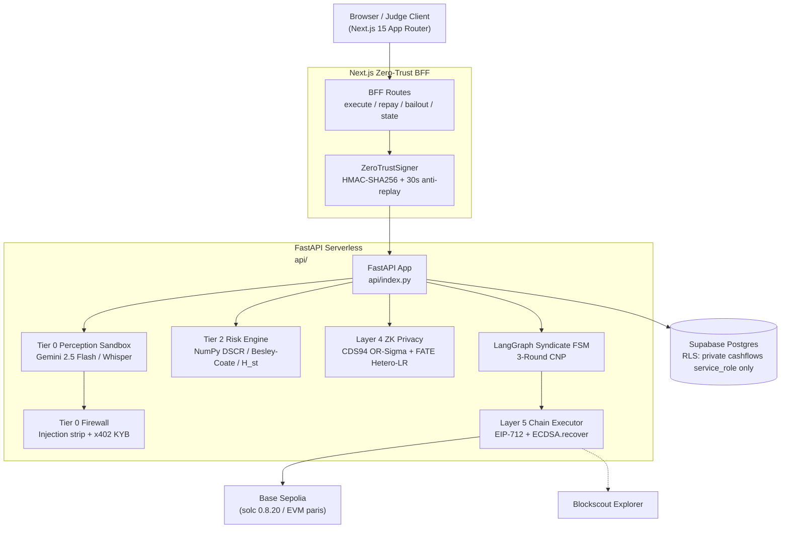

# KendraFi Architecture — SaaS Readiness Plan (Part 2)

> **For agentic workers:** produced per `docs/plans/part-2-system-architecture.md` (Task 1 of 4).
> **Spec:** `extraction_1792747023602.md` — Part 2: "System architecture", pp. 6–7, sections "What it is", "What AI agents get wrong", "Decisions you own", prompts 2a–2c, verify block.
> **Master spec:** `CONTEXT.md` (§2 wins on conflicts) · **Date:** 2026-10-23

## 1. Purpose & Scope

This document locks the target architecture for KendraFi at the current stage (SaaS-readiness plan series, Part 2) into a single written artifact, plus the decision log in `/docs/decisions/`.

- **In scope:** architecture doc, ADRs, scaffold checklist.
- **Out of scope:** database schema (Part 3), auth implementation (Part 4), feature code, runtime changes.

## 2. Component Diagram (Mermaid)



## 3. Stack Per Layer (with one rejected alternative each)

| Layer | Choice | Rejected alternative |
| :--- | :--- | :--- |
| **Perception (Tier 0)** | Google Gemini 2.5 Flash multimodal + Bangla Whisper; parallel injection strip + x402 KYB check. | OpenAI GPT-4o + Whisper pipeline — extra vendor surface for no demo advantage. |
| **Smart accounts (Tier 1)** | ERC-4337 `AgentSessionAccount.sol` (`maxAlphaBps = 4000`), solc 0.8.20. | EOA custodial wallets — loses bounded authority story. |
| **Risk engine (Tier 2)** | Pure NumPy (`api/core/risk_engine.py`) — DSCR, Besley-Coate, Ghatak, collusion entropy. | scipy/sklearn inside serverless bundle; LLM arithmetic (RULE 1 forbids both). |
| **ZK privacy (Layer 4)** | secp256k1 Pedersen + 16-bit CDS94 OR-Sigma + FATE Hetero-LR. | Groth16/SNARK circuits — disproportionate ops cost at demo scale. |
| **FSM / CNP (Layer 2)** | LangGraph 5-state FSM with genuine 3-round Contract Net Protocol. | Hand-rolled state machine without durable state store. |
| **Escrow (Layer 5)** | Solidity 0.8.20, `evm_version = "paris"`, 4-of-5 EIP-712 quorum via `ECDSA.recover`. | Solidity ≥0.8.24 (emits `PUSH0`, breaks FISCO BCOS v3). |
| **Data / auth** | Supabase Postgres (RLS; Prisma client maps to same tables) + Supabase Auth + HMAC-SHA256 BFF↔FastAPI bridge. | Self-hosted RDS + Drizzle — ops burden contradicts solo-stage needs. |
| **Frontend / BFF** | Next.js 15 App Router + TypeScript strict + Tailwind. | Remix / Pages Router — App Router already scaffolded. |
| **Backend runtime** | FastAPI (Vercel Python serverless) behind Next.js BFF. | Node-only backend — Python/NumPy split is required for zero-LLM-math rule. |
| **Hosting** | Vercel (Next.js + Python runtime, <65 MB bundle). | Railway / Fly.io — Vercel matches existing BFF + Python serverless shape. |

## 4. Folder Structure

Canonical layout (per `CONTEXT.md` §2 and existing repo):

```text
kendrafi/
├── CONTEXT.md / docs/            # Master spec + architecture, decisions, traces, plans
├── src/                          # Next.js 15 App Router (BFF routes + views)
│   └── app/api/kendra/{execute,repay,bailout,state}/route.ts
├── api/                          # FastAPI serverless (Tier 0–5 engine)
│   └── core/{perception_sandbox,risk_engine,zk_fate_privacy,syndicate_fsm,chain_executor,schemas,zerotrust_guard}.py
├── contracts/                    # Foundry (solc 0.8.20, paris), tests, deploy scripts
├── supabase/migrations/          # RLS + nonce RPC schema
├── prisma/schema.prisma          # Prisma models mapped to Supabase Postgres
├── tests/                        # Prompt-level pytest suites (risk, perception, ZK, FSM, chain)
├── docs/traces/                  # FSM state traces (scenarios A/B/C)
└── docs/plans/                   # SaaS-readiness plan series (Parts 0–15)
```

## 5. Background Job Placement

- **Decision (locked in this part):** background jobs — daily MFS repayment sweep, future emails/webhooks/exports — run out of the synchronous HTTP request path. At current scale the daily sweep is ~0.0023 QPS (200 merchants) and negligible, but the placement must not silently regress into request-path execution at scale.
- **Mechanism (proposed):** server-side scheduled job (Supabase `pg_cron` / Vercel Cron) writing to a job table; workers idempotent with retry/backoff.
- **Deferred:** queue infra (Inngest / BullMQ / pgmq) only if job volume justifies it (see Parts 5 & 15).

## 6. Third-Party Services & Cost at Current Scale

| Service | Purpose | Cost at current scale (2026-10) |
| :--- | :--- | :--- |
| Vercel | Hosting (Next.js + Python serverless) | $0 (hobby) |
| Supabase | Postgres + Realtime + pg_cron + RLS | $0–$25/mo |
| Google Gemini API | Tier-0 multimodal OCR / Bangla audio | ~$0–$10/mo at demo volume |
| OpenAI Whisper | Tier-0 transcription (optional) | ~$0–$5/mo |
| Base Sepolia RPC | Layer-5 settlement (testnet) | $0 |
| Blockscout | Tx explorer / verification | $0 |
| Foundry / Anvil | Local chain + fuzz tests | $0 |

**Total at current scale:** well under **$50/mo**; ~**$200–300/mo** at 10x scale (Gemini + Supabase pro).

## 7. Top-3 Riskiest Decisions

1. **Single-serverless-function composition** (perception → risk → ZK → CNP → escrow in one Vercel Python function, 1024 MB / 60 s ceilings). First bottleneck identified in Part 1 §9. Mitigation: split into separate functions before scale.
2. **HMAC trust-boundary secret handling** — BFF reads `ZEROTRUST_INTERNAL_HMAC_SECRET` via filesystem `.env` fallback while FastAPI reads env; divergence risk. Mitigation: explicit env injection, fail-loud at startup.
3. **Year-one individual-merchant tenancy** (single-tenant ledgers; multi-tenant tiers deferred). Mitigation: RLS zero-anon policy is deliberate; future org/team tiers must ship migrations (Part 3).

## 8. Verification (Part 2 Task 4 — executed 2026-10-23)

- **Diagram boxes explained** — every node in §2 maps to a file in §4: BFF routes → `src/app/api/kendra/*/route.ts` (thin HMAC proxies), ZeroTrustSigner → `src/lib/zerotrust.ts`, FastAPI app → `api/index.py`, Tier-0 → `api/core/perception_sandbox.py`, Tier-2 → `api/core/risk_engine.py`, ZK → `api/core/zk_fate_privacy.py`, FSM/CNP → `api/core/syndicate_fsm.py`, Chain executor → `api/core/chain_executor.py`, DB → `supabase/migrations/` + `prisma/schema.prisma`, chain → `contracts/src/KendraEscrow.sol`, explorer → `NEXT_PUBLIC_BLOCKSCOUT_TX_BASE_URL`.
- **Every dependency has a reason** — audited 2026-10-23; removed 5 declared-but-never-imported deps (`@supabase/server`, `clsx`, `framer-motion`, `tailwind-merge`, `viem`). Remaining reasons below.
- **Business-logic layering** — financial/protocol logic lives in the dedicated engine layer `api/core/`; BFF routes are thin HMAC proxies (~15 lines, zero logic); UI components render only. Rule satisfied. Typecheck green after all changes; `/api/health` returned HTTP 200 from the running dev server.

### Dependency reasons (package.json)

| Dependency | Reason |
| :--- | :--- |
| `next` / `react` / `react-dom` | App Router framework + UI runtime |
| `@supabase/supabase-js` | Service-role server client + browser Realtime client (`src/lib/supabase-*.ts`) |
| `@supabase/ssr` | Cookie-based SSR Supabase clients (`utils/supabase/`) |
| `server-only` | Compile-time guard keeping the service-role client out of the browser bundle |
| `lucide-react` | Icon set used across the judge panels |
| `@prisma/client` + `prisma` (dev) | Typed Postgres models mapped to the Supabase schema |
| `typescript` + `@types/*` (dev) | Strict TS toolchain (`strict: true`) |
| `tailwindcss` + `postcss` + `autoprefixer` (dev) | Styling pipeline per `DESIGN.md` |
| `eslint` + `eslint-config-next` + `@typescript-eslint/*` (dev) | Linter scaffold (Part 2 Task 3) |
| `prettier` (dev) | Formatter scaffold (Part 2 Task 3) |

Python (`api/requirements.txt`): `fastapi` (HTTP) · `uvicorn` (runtime) · `pydantic` (contract schemas) · `numpy` (Tier-2 math) · `ecdsa` + `pycryptodome` (EIP-712 / secp256k1 ZK) · `web3` + `eth-account` (relayer) · `supabase` (DB writes) · `httpx` (Tier-0 calls) · `langgraph` (FSM). `scipy`/`sklearn` deliberately excluded (<65 MB serverless bundle).
