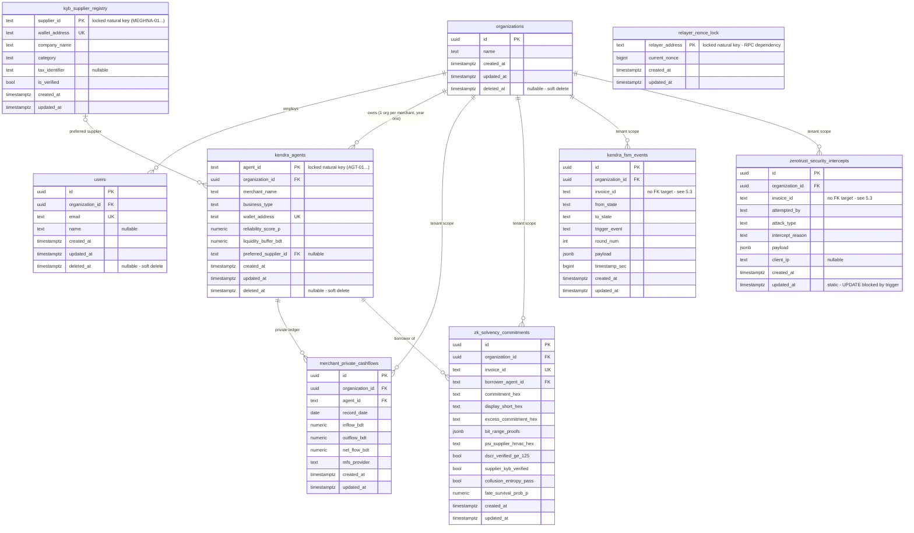

# KendraFi Database Schema — Multi-Tenant SaaS Design (Part 3, Task 1)

> **Canonical schema:** `prisma/schema.prisma` (Prisma 7.10, PostgreSQL / Supabase).
> This document is the design rationale: ERD, per-index rationale, tenancy mapping,
> soft-delete/money/timestamp decisions, and hand-off notes for Task 2 (migrations/seed)
> and Part 4 (auth).
>
> **Locked baseline:** `supabase/migrations/20261015000000_kendra_zerotrust_schema.sql`
> is frozen (CONTEXT.md). This design is **additive-only** relative to it: existing
> `@@map` table names, natural-key PKs, and RLS (DENY-ALL on `merchant_private_cashflows`)
> are preserved. No migration is authored here — Task 2 owns that.

---

## 1. Entity-Relationship Diagram

`relayer_nonce_lock` has no edges: it is platform infrastructure, not tenant data.

---

## 2. Tenancy Mapping (per `docs/system-design.md` §3)

| Model | Table | Tenant-scoped? | Rationale |
| :--- | :--- | :---: | :--- |
| `Organization` | `organizations` | — (tenant root) | The tenant itself. Year one: **one organization per individual merchant**. |
| `User` | `users` | ✅ `organization_id` FK | Org member; year one = merchant principal. |
| `KendraAgent` | `kendra_agents` | ✅ `organization_id` FK | Each merchant agent is owned by its org (1:1 with orgs in year one; N:1 already supports the future org tier without schema change). |
| `MerchantPrivateCashflow` | `merchant_private_cashflows` | ✅ `organization_id` FK | Denormalized org FK so RLS policies never need a join to `kendra_agents`. DENY-ALL RLS from the locked migration stays untouched. |
| `ZkSolvencyCommitment` | `zk_solvency_commitments` | ✅ `organization_id` FK | Attributed to the **borrower's** org. |
| `KendraFsmEvent` | `kendra_fsm_events` | ✅ `organization_id` FK | Attributed to the acting agent's org; Realtime SELECT policies unchanged. |
| `ZeroTrustSecurityIntercept` | `zerotrust_security_intercepts` | ✅ `organization_id` FK | Attributed to the acting (attacking) agent's org, so each tenant sees only its own intercepts. |
| `KybSupplier` | `kyb_supplier_registry` | ❌ deliberate | Platform-shared counterparty whitelist (public read RLS). Org-scoping it would break the shared x402 semantics — every tenant validates against the same suppliers. |
| `RelayerNonceLock` | `relayer_nonce_lock` | ❌ deliberate | Platform relayer infrastructure (one hot row per relayer address). |

**Cross-tenant participation is intentional.** A CNP syndicate spans orgs (a guarantor in org X signs for a borrower in org Y), but `organization_id` scopes row **ownership**, not participation: guarantor stakes live on-chain and inside `kendra_fsm_events.payload` / commitment JSON — no cross-org FK rows are introduced. Cross-tenant visibility remains limited to anonymized aggregate syndicate telemetry, per §3 of the system design.

---

## 3. Index Rationale

Postgres does not auto-index FK columns, so every FK gets an explicit index. Existing unique constraints are listed because they double as access paths.

| Table | Index / Constraint | Columns | Serves |
| :--- | :--- | :--- | :--- |
| `users` | `email` UNIQUE | `email` | Login lookup (Part 4); global uniqueness — email identifies the human across orgs. |
| `users` | `users_organization_id_deleted_at_idx` | `(organization_id, deleted_at)` | Per-org **active** user listing (`WHERE organization_id = ? AND deleted_at IS NULL`); leading column also covers the org FK. |
| `kendra_agents` | `wallet_address` UNIQUE | `wallet_address` | EIP-55 wallet uniqueness + x402/escrow lookups. |
| `kendra_agents` | `kendra_agents_organization_id_idx` | `organization_id` | Org FK; "agents of org" scan. |
| `kendra_agents` | `kendra_agents_preferred_supplier_id_idx` | `preferred_supplier_id` | FK index that was **missing** before — reverse lookup (supplier → agents) previously seq-scanned. |
| `merchant_private_cashflows` | `uq_agent_record_date` UNIQUE | `(agent_id, record_date)` | One ledger row per agent per day; leading column doubles as the `agent_id` FK index **and** the 90-day DSCR window query (`WHERE agent_id = ? ORDER BY record_date`). No separate `agent_id` index needed (btree leftmost-prefix rule). |
| `merchant_private_cashflows` | `merchant_private_cashflows_organization_id_idx` | `organization_id` | Org FK + future per-org RLS without join. |
| `zk_solvency_commitments` | `invoice_id` UNIQUE | `invoice_id` | One commitment per invoice; judge-panel lookup. |
| `zk_solvency_commitments` | `zk_solvency_commitments_organization_id_idx` | `organization_id` | Org FK. |
| `zk_solvency_commitments` | `zk_solvency_commitments_borrower_agent_id_idx` | `borrower_agent_id` | Borrower FK index that was **missing** before. |
| `kendra_fsm_events` | `kendra_fsm_events_organization_id_idx` | `organization_id` | Org FK. |
| `kendra_fsm_events` | `kendra_fsm_events_invoice_id_timestamp_sec_idx` | `(invoice_id, timestamp_sec)` | The dominant trace query — `WHERE invoice_id = ? ORDER BY timestamp_sec` (CNP timeline pagination + Realtime polling). Was **completely unindexed** before. |
| `zerotrust_security_intercepts` | `zerotrust_security_intercepts_organization_id_created_at_idx` | `(organization_id, created_at)` | Per-org recent-intercepts feed (RED ALERT panel), newest first. |
| `zerotrust_security_intercepts` | `zerotrust_security_intercepts_invoice_id_idx` | `invoice_id` | Per-invoice intercept lookup. Was unindexed. |
| `kyb_supplier_registry` | PK + `wallet_address` UNIQUE | `supplier_id`, `wallet_address` | x402 KYB verification lookups. `category` deliberately not indexed: ~row-count-of-dozens reference table. |
| `organizations` | PK only | `id` | `deleted_at` filter deliberately not indexed: tenant count is tiny (2 orgs in seed; thousands at most); revisit only at real org scale. |
| `relayer_nonce_lock` | PK | `relayer_address` | The locked `get_and_increment_nonce(addr)` RPC updates by this key — nothing else needed. |

---

## 4. Soft Deletes, Timestamps, IDs

### 4.1 Soft-delete choices

| Table | Soft delete? | Why |
| :--- | :---: | :--- |
| `organizations` | ✅ `deleted_at` | Tenant offboarding without orphaning FK'd history. |
| `users` | ✅ `deleted_at` | Churn/deactivation without breaking FK references; re-activation semantics are Part 4's call. |
| `kendra_agents` | ✅ `deleted_at` | Merchant churn while preserving guarantor/borrower history in commitments. |
| `kyb_supplier_registry` | ❌ | Delisting is already modeled: `is_verified = false`. |
| `merchant_private_cashflows` | ❌ | Append-only financial ledger feeding DSCR; a soft-delete flag would let risk math silently drift. Corrections are new rows. |
| `zk_solvency_commitments` | ❌ | Cryptographically anchored proofs — deletion (soft or hard) is tampering. |
| `kendra_fsm_events` | ❌ | FSM trace is an audit record. |
| `zerotrust_security_intercepts` | ❌ | **Cannot** have one: the locked `prevent_audit_tampering` trigger prohibits `UPDATE`, so `deleted_at` could never be set. |
| `relayer_nonce_lock` | ❌ | Mutable nonce counter, not a business entity. |

### 4.2 Timestamps

Every table now carries `created_at` + `updated_at`. `updated_at` uses `@default(now()) @updatedAt` everywhere **except** `zerotrust_security_intercepts`, which uses a plain default: the immutability trigger makes any update raise, so `@updatedAt` could only ever produce a runtime exception there — the column is static and equals `created_at` by construction. `relayer_nonce_lock` gains `created_at` additively; the locked RPC inserts name their columns explicitly, so the default keeps them working.

### 4.3 Primary keys

New tables (`organizations`, `users`) use UUID `gen_random_uuid()` ids, matching the existing pattern. Three pre-existing **natural-key PKs are deliberately kept** (`kendra_agents.agent_id`, `kyb_supplier_registry.supplier_id`, `relayer_nonce_lock.relayer_address`): the locked migration's seeds, FKs, `CHECK`s, and the `get_and_increment_nonce(addr)` RPC all depend on these exact keys; replacing them with surrogates would break the locked SQL and the demo (`AGT-01`..`AGT-05` are hard-wired through API code, traces, and contracts). This is the one documented deviation from "UUID id on every table".

---

## 5. Design Notes

### 5.1 Money representation (constraint: never floats)

Audit result: **no persisted float exists** — all money and risk numbers are Prisma `Decimal` → Postgres `NUMERIC` at fixed scale:

| Column | Type |
| :--- | :--- |
| `liquidity_buffer_bdt`, `inflow_bdt`, `outflow_bdt`, `net_flow_bdt` | `NUMERIC(12, 2)` |
| `reliability_score_p`, `fate_survival_prob_p` | `NUMERIC(5, 4)` |

`NUMERIC(12,2)` is the "Decimal with fixed scale" option the global constraint allows. BDT has 2 poisha decimals and every locked benchmark (`45,462.33`, `18,184.93`, `675.00`, …) is 2dp, so converting to integer minor units would churn every locked constant for zero benefit. Tier-0 Pydantic `amount_bdt: float` is a **transient OCR field** (CONTEXT.md §4) that is never persisted — out of scope per task ruling; Part 5 should still map it to `Decimal` on write.

### 5.2 CHECK constraints — Task 2 must carry these into SQL

Prisma cannot express `CHECK`, so NOT NULL / UNIQUE live in the schema, and the following CHECKs are **migration requirements** for Task 2. The first four already exist in the locked SQL and must survive:

| Constraint | Source |
| :--- | :--- |
| `kendra_agents.reliability_score_p BETWEEN 0 AND 1` | locked SQL — preserve |
| `kendra_agents.liquidity_buffer_bdt >= 0` | locked SQL — preserve |
| `merchant_private_cashflows.inflow_bdt >= 0` | locked SQL — preserve |
| `merchant_private_cashflows.outflow_bdt >= 0` | locked SQL — preserve |
| `kendra_agents.agent_id ~ '^AGT-0[1-5]$'` | locked SQL — **must be relaxed/dropped** by Task 2; it caps the platform at 5 agents and blocks multi-tenancy |
| `merchant_private_cashflows.net_flow_bdt = inflow_bdt - outflow_bdt` | recommended new — add only after Task 2's seed conformance check |

### 5.3 Deliberate gaps (not oversights)

- **No `invoices`/`facilities` table.** `invoice_id` is a natural cross-reference key appearing in three tables with no FK target. Loan-lifecycle modeling (principal, APR, status, guarantor join rows) is Part 5's scope; adding it now would be speculative.
- **No billing/plan/tier/role/password columns anywhere** — Part 4 owns auth and org membership semantics.
- `users.email` is **globally** unique (login identity), not per-org.

### 5.4 Part 4 (auth) reconcile notes

- `users` is a minimal placeholder: UUID id, `organization_id` FK (NOT NULL, single-org membership is the year-one model), unique email, optional name, timestamps, soft delete. Part 4 will reconcile `public.users` ↔ Supabase `auth.users` (e.g., auth-side id FK or a view) and may introduce membership/roles.
- Per-org RLS policies (e.g., `organization_id = (auth.jwt() ->> 'org_id')::uuid`) are Part 4 work; Part 3's job was only to guarantee the column exists on every tenant row.
- The DENY-ALL RLS on `merchant_private_cashflows` (service_role only) is untouched and must remain the strongest policy in the stack.

### 5.5 Task 2 (migration/seed) mechanics — critical hand-off

1. **Additive-only vs the locked SQL.** The 7 locked tables already exist in the Supabase project. Task 2 must baseline them (`prisma migrate diff` / introspection) and ALTER additively — never regenerate the locked DDL, never edit `supabase/`.
2. **NOT NULL backfill order.** `organization_id` is NOT NULL on six tables: create `organizations` → create per-tenant orgs → add the column (nullable/defaulted) → backfill from the owning agent → `SET NOT NULL` → attach the FK.
3. **Immutability-trigger hazard.** Backfilling `organization_id`/`updated_at` on *existing* `zerotrust_security_intercepts` rows requires `UPDATE`, which `prevent_audit_tampering` blocks. The migration must `DISABLE TRIGGER prevent_audit_tampering`, backfill, re-enable — or run before any intercept rows exist (fresh DB).
4. **Locked seed re-run caveat.** The locked SQL's `INSERT`s name their columns explicitly and omit the new columns, so every added column carries a DB default — but `organization_id` cannot be defaulted. After Task 2, never re-run the locked seed standalone against an empty, post-migration `kendra_agents` (its INSERT would violate NOT NULL). Task 2's Prisma seed supersedes the locked seed for org-attributed data.
5. **Seed shape.** 2 organizations × 3 users + org attribution for the demo agents (year one: `AGT-01` → org 1, peers → org 2, etc. — exact mapping is Task 2's call).

### 5.6 File storage: N/A (Part 3, Task 3 ruling)

No file uploads exist anywhere in the codebase — no upload endpoints in `src/app/api/**`, no multipart/storage SDK code in `src/` or `api/`; `public/` and `test-invoices/` are static assets. The pre-signed-URL/private-bucket deliverable is therefore N/A. When uploads arrive (e.g., invoice scans via the perception sandbox), the rule is: private-by-default bucket, access only through short-lived pre-signed URLs, and object paths keyed by `organization_id` so tenant isolation starts at storage, not just at the database.

---

## 6. Verification

- `npx prisma validate` → **valid** against Prisma CLI 7.10.0 (config from `prisma.config.ts`).
- `npx prisma format` → applied, idempotent.
- No migration authored, no DB touched, `supabase/` untouched (locked).
